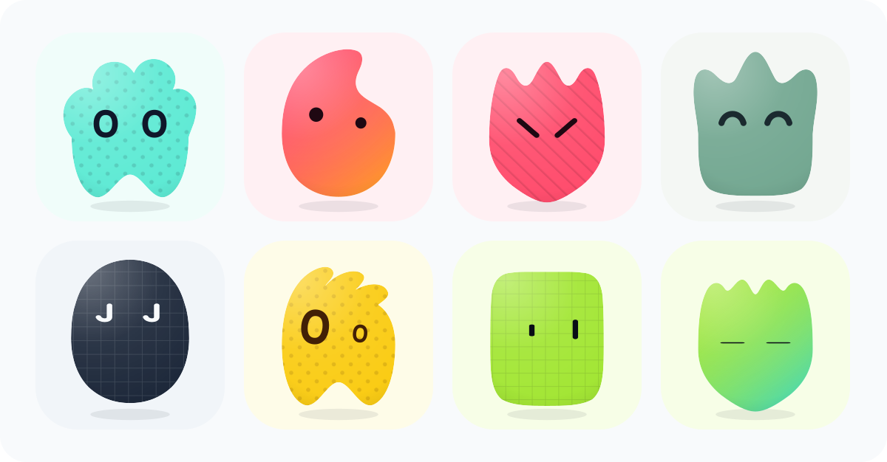
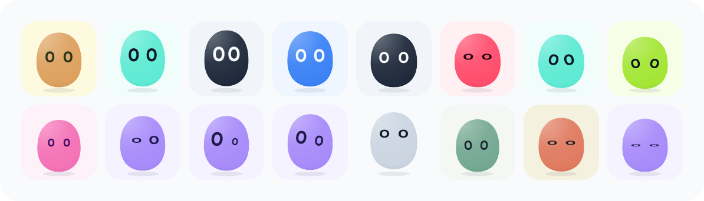

# Moldy — Interactive Procedural Pets by [@Gomand06](https://github.com/Gomand06)

**Moldy** es un playground web interactivo para descubrir, personalizar y exportar mascotas 2D procedurales llenas de vida, color y actitud.

✨ **Pruébalo en vivo:** **[https://moldy-xi.vercel.app/](https://moldy-xi.vercel.app/)**  
📸 **Instagram:** **[@thegomand](https://www.instagram.com/thegomand/)**  
☕ **Apoya el proyecto:** **[Ko-fi](https://ko-fi.com/thegomand)**  
📦 **Repositorio Showcase:** **[https://github.com/Gomand06/Moldy](https://github.com/Gomand06/Moldy)**


---

## Galería de Mascotas

Cada mascota combina siluetas orgánicas sin bordes, sombreado volumétrico suave, paletas de alto contraste y texturas recortadas que se adaptan armónicamente a cada personaje.



---

## Personalidad Interactiva y 16 Actitudes Cinemáticas

Cada mirada cobra vida propia. Combina los distintos estilos de ojos con **16 actitudes cinemáticas** que transforman la expresión, la postura y el comportamiento de tu mascota en tiempo real.



---

## Características Principales

- **Personalidad Interactiva (16 Actitudes Cinemáticas)**: Explora estados como *Neutral*, *Attentive*, *Surprised*, *Excited*, *Happy*, *Laughing*, *Angry*, *Sad*, *Scared*, *Suspicious*, *Confused*, *Curious*, *Proud*, *Shy*, *Unimpressed* y *Sleepy*.
- **Seguimiento de Mirada en Tiempo Real**: Los ojos y el cuerpo responden suavemente a la posición del cursor o toque en pantalla, adaptando su velocidad y carácter según la emoción activa.
- **Física *Squish* al Clic**: Toca o haz clic sobre tu mascota para activar una reacción elástica de compresión y rebote (*boop*).
- **Respiración Orgánica y Parpadeo Natural**: Ciclo continuo de respiración suave, sombra reactiva y parpadeo espontáneo con variaciones naturales.
- **Generación Determinista por Semilla (`?seed=`)**: Cada mascota genera un enlace único en la barra de direcciones (`https://moldy-xi.vercel.app/?seed=...`) para que puedas guardar o compartir tu creación exacta con cualquier persona.
- **Exportación Instantánea**: Copia el vector `.SVG` directo al portapapeles o descarga tu mascota en `.SVG` y `.PNG` de alta resolución en un clic.

---

## Licencia y Uso Libre con Atribución (CC BY 4.0)

Cualquier persona puede descargar y utilizar las mascotas exportadas (`.SVG` y `.PNG`) en **proyectos personales o comerciales de forma totalmente gratuita** bajo la licencia **[Creative Commons Attribution 4.0 (CC BY 4.0)](./LICENSE.md)**, simplemente dando crédito visible a **[@Gomand06](https://github.com/Gomand06)** y enlazando a **[Moldy](https://moldy-xi.vercel.app/)**.

> **Nota sobre el generador:** La licencia CC BY 4.0 aplica a las mascotas e ilustraciones exportadas. La clonación, reempaquetado o redistribución del generador web completo como servicio o producto independiente no está permitida. Consulta [`LICENSE.md`](./LICENSE.md) para más información.

### Cómo dar crédito (Copia y pega)

- **En Markdown:**
  ```markdown
  Mascotas generadas con [Moldy](https://moldy-xi.vercel.app/) por [@Gomand06](https://github.com/Gomand06/Moldy)
  ```

- **En HTML:**
  ```html
  Mascotas generadas con <a href="https://moldy-xi.vercel.app/" target="_blank" rel="noopener">Moldy</a> por <a href="https://github.com/Gomand06/Moldy" target="_blank" rel="noopener">@Gomand06</a>
  ```

---

## Apoya a Moldy

Si usas **Moldy** en tus proyectos o te gusta lo que estamos creando, puedes apoyar su desarrollo:

- ☕ **Apóyame en Ko-fi:** [https://ko-fi.com/thegomand](https://ko-fi.com/thegomand)
- 📸 **Sígueme en Instagram:** [@thegomand](https://www.instagram.com/thegomand/)
- ⭐ **Dale una estrella** a este repositorio en [GitHub](https://github.com/Gomand06/Moldy)

---

Creado por **[@Gomand06](https://github.com/Gomand06)** · [Instagram @thegomand](https://www.instagram.com/thegomand/) · [moldy-xi.vercel.app](https://moldy-xi.vercel.app/)
